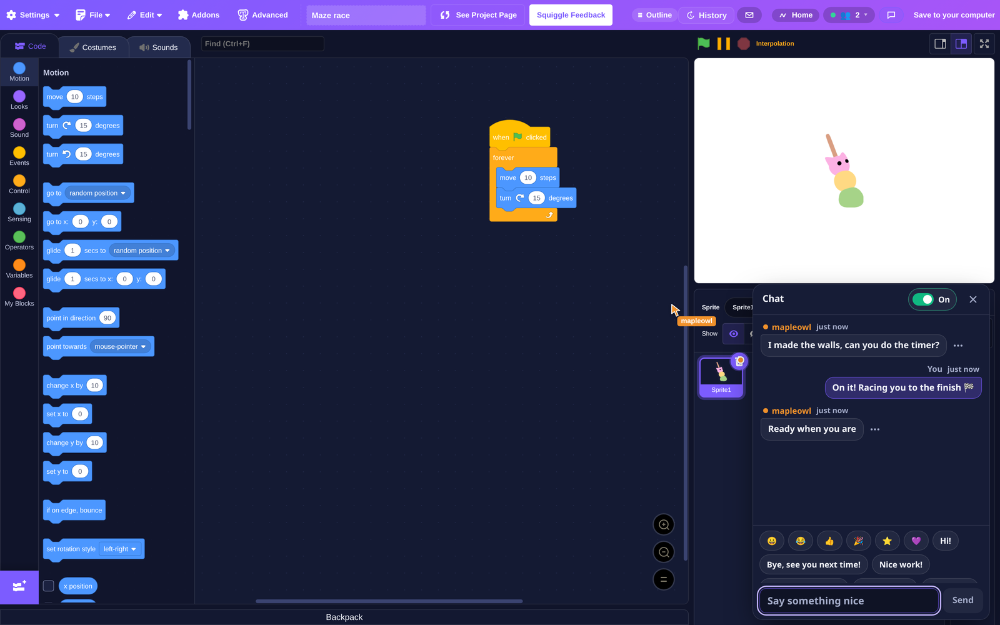
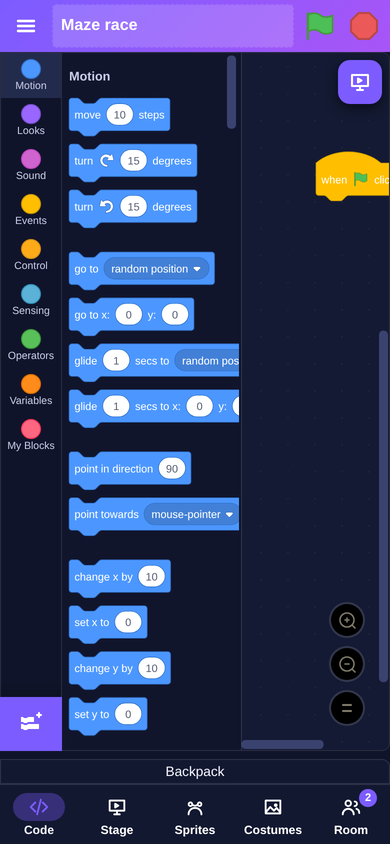
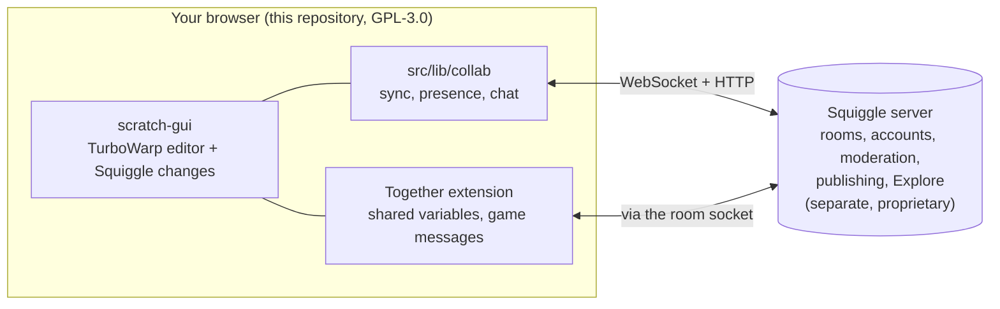

# Squiggle

**Make a Scratch-style project with a friend, in the same editor, at the same time.**

Squiggle is a [TurboWarp](https://turbowarp.org) fork (itself built on
[Scratch](https://scratch.mit.edu)) with a multiplayer client built in. Open a
room, invite someone, and every block you snap, sprite you drag and stroke you
paint shows up on their screen as you do it. Then hit the green flag and play
the game you built together.

<p align="center">
  <a href="https://squigglegames.app"><b>Play now</b></a> ·
  <a href="https://discord.gg/8rc63SwhvW"><b>Discord</b></a> ·
  <a href="https://www.reddit.com/r/SquiggleGames/"><b>r/SquiggleGames</b></a> ·
  <a href="./CHANGELOG.md">Changelog</a> ·
  <a href="./CONTRIBUTING.md">Contributing</a>
</p>

<p align="center">
  <a href="https://github.com/Nickalus12/SquiggleGames/actions/workflows/editor.yml"></a>
  <a href="https://github.com/Nickalus12/SquiggleGames/releases"></a>
  <a href="./LICENSE"></a>
  <a href="https://github.com/Nickalus12/SquiggleGames/labels/good%20first%20issue"></a>
  <a href="https://discord.gg/8rc63SwhvW"></a>
  <a href="https://www.reddit.com/r/SquiggleGames/"></a>
</p>

<p align="center">
  
  &nbsp;
  
</p>

> Not affiliated with or endorsed by the Scratch Team or TurboWarp. "Scratch" is
> a trademark of the Scratch Foundation and is used here only to describe what
> this interoperates with.

## What you can do

| | |
|---|---|
| **Build together, live** | Blocks, sprites, costumes, sounds, paint strokes and green-flag runs replay on everyone's screen. Each player has a cursor and a name tag, so you can see who is working where. |
| **Make multiplayer games** | The **Together** extension adds shared variables and game messages that travel between running projects, so two players can race, chase or keep score across screens. See [docs/TOGETHER.md](./docs/TOGETHER.md). |
| **Talk in the room** | A chat panel lives next to the editor. Younger players and guests get a set of quick phrases instead of a keyboard, and anyone can report a line in plain words. |
| **Use a phone or tablet** | On a small screen the editor becomes one pane at a time with tabs along the bottom, and games get on-screen arrow and space keys. |
| **Share it** | Publish to [Explore](https://squigglegames.app/explore), and anyone can play your project full screen at `/play`, no account needed. |
| **Take it with you** | Projects are plain `.sb3` files. Download one and it opens in Scratch or TurboWarp. |

## How it fits together



Every browser runs the project on its own. Motion is computed locally on each
side and only the values a project explicitly shares travel between players.
That is deliberate: it keeps two copies of the same script from fighting each
other.

This repository is **the editor only**, the part that runs in your browser. It
is GPL-3.0 because it derives from TurboWarp. The server it talks to is a
separate program and is not in this repository; see [License](#license).

## Where things live

| Path | What |
|---|---|
| `scratch-gui/` | The editor: a clone of `TurboWarp/scratch-gui` with Squiggle's changes |
| `scratch-gui/src/lib/collab/` | The browser half of the multiplayer protocol: sync, reconnects, presence overlay, room chat |
| `scratch-gui/src/components/collab-chat/` | The room chat panel, quick phrases, report sheet and the Messages button |
| `scratch-gui/src/components/phone-shell/` | The phone layout: top bar, bottom tabs, sprite row, mini stage |
| `scratch-gui/src/lib/libraries/extensions/together/` | The Together extension |
| `docs/TOGETHER.md` | How to build a multiplayer game with Together |
| `tools/demo-video/` | Tooling for the demo video |

## Run it

Needs **Node 22.13 or newer**.

```bash
git clone https://github.com/Nickalus12/SquiggleGames.git
cd SquiggleGames/scratch-gui
npm install
NODE_OPTIONS=--openssl-legacy-provider npm start      # http://localhost:8601
```

That is a full editor with hot reload. It runs single-player out of the box,
which is enough for most changes. To try anything that syncs, point it at a
server with `?server=ws://host:4455` and open the same room in a second browser
profile.

Production bundle:

```bash
NODE_OPTIONS="--openssl-legacy-provider --max-old-space-size=4096" npm run build
```

Tests and lint, the same checks CI runs on every pull request:

```bash
npx eslint src/lib/collab --ext .js,.jsx
node src/lib/libraries/extensions/together/together.test.mjs
for t in src/lib/collab/*.test.mjs; do node "$t"; done
```

None of these need a browser or a server.

## Community

Squiggle has three places to talk, and they are wired together so nothing gets
lost between them.

| I want to... | Go to |
|---|---|
| Ask for help, find someone to build with | [Discord](https://discord.gg/8rc63SwhvW) `#help` and `#find-a-partner`, or a **Help** / **Room Invite** post on Reddit |
| Show off something I made | Discord `#showcase`, or a **Showcase** post on [r/SquiggleGames](https://www.reddit.com/r/SquiggleGames/) |
| Report a bug | `/bug` in Discord, or [open an issue](https://github.com/Nickalus12/SquiggleGames/issues/new/choose) |
| Suggest a block or a feature | Discord `#feature-ideas`, or a [feature issue](https://github.com/Nickalus12/SquiggleGames/issues/new/choose) |
| See what changed | [CHANGELOG.md](./CHANGELOG.md), [Releases](https://github.com/Nickalus12/SquiggleGames/releases), Discord `#devlog` |
| Write code | [CONTRIBUTING.md](./CONTRIBUTING.md) and the [good first issues](https://github.com/Nickalus12/SquiggleGames/labels/good%20first%20issue) |

How they connect:

- `/bug` in Discord files a GitHub issue for you and links it back in the channel.
- When an issue is fixed or an idea ships, its Discord thread is updated to say so.
- Every commit merged to `main` here is posted to Discord `#devlog`.
- r/SquiggleGames uses the same buckets as flairs: Showcase, Help, Bug, Idea,
  Room Invite, Tutorial, Announcement and Devlog.

## Kids are here

Squiggle is built for young makers, and that shapes the product:

- Accounts for children under 13 need a grown-up's consent. If no grown-up
  answers, the account is removed on the date the child was shown.
- There are no private messages between players. Room chat is visible to
  everyone in the room, and younger players use quick phrases only.
- Text that other people will see is checked before it is shown. Signed-in
  players can report a chat line, a room or a project.
- The hosted service keeps daily counts, with no access log, no tracking
  cookie and no third-party script. The details are at
  [squigglegames.app/privacy](https://squigglegames.app/privacy).

The [Code of Conduct](./CODE_OF_CONDUCT.md) applies everywhere: here, Discord and
Reddit.

## Security

Found something that could hurt a user, such as account takeover, data
exposure, or a way past moderation? Please don't open a public issue.
[SECURITY.md](./SECURITY.md) has the private route.

## License

**GPL-3.0**, for the contents of this repository. The editor derives from
[TurboWarp/scratch-gui](https://github.com/TurboWarp/scratch-gui) (GPL-3.0),
which builds on Scratch by the Scratch Foundation. See [LICENSE](./LICENSE).

The Squiggle server is a **separate and independent program**. It is not part of
this repository, is not distributed with it, and is not licensed under the GPL.
The editor communicates with it at arm's length over a WebSocket and HTTP
interface, exchanging data rather than linking code. Running this editor against
the hosted service, or against any other server, does not place that server
under this license.
